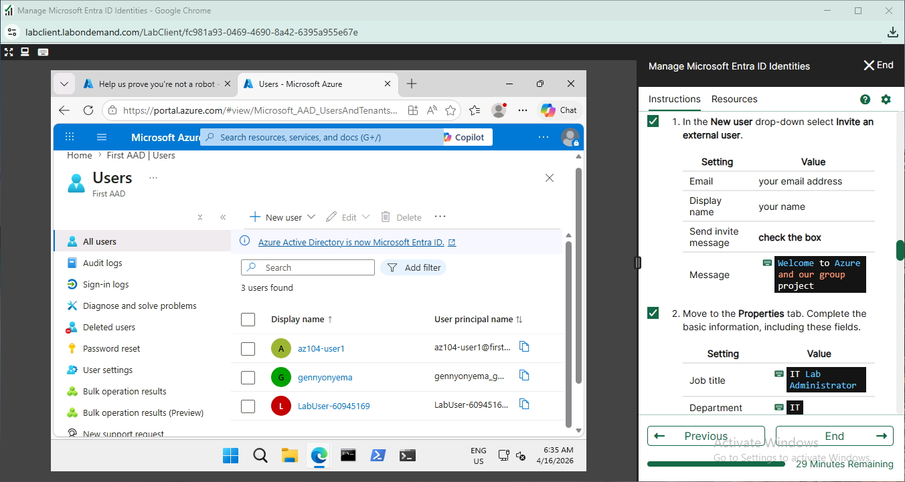
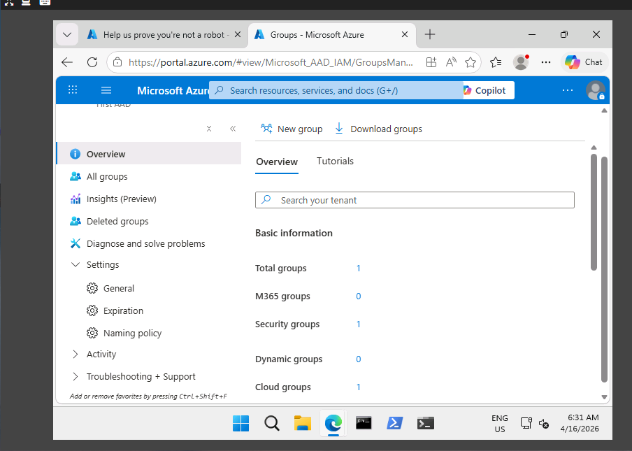
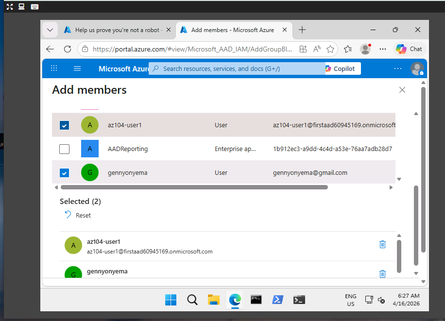

# AZ-104 Lab 01: Manage Microsoft Entra ID Identities (Users and Groups)

**Author:** Nenye
**Certification track:** Microsoft Azure Administrator (AZ-104)
**Duration:** ~30 minutes
**Region:** East US
**Skills demonstrated:** Microsoft Entra ID, user provisioning, guest (external) users, dynamic group membership, identity management

---

## Overview

Users and groups are the basic building blocks of any identity solution. In this lab I used Microsoft Entra ID to provision user accounts and create a group whose membership updates automatically based on job title.

## Scenario

My organization is building a new lab environment for pre-production testing of apps and services. A few engineers are being hired to manage the lab environment, including the virtual machines. To let them authenticate with Microsoft Entra ID, I was tasked with provisioning users and groups. To minimize administrative overhead, group membership had to update automatically based on job title.

## Objectives

| # | Task |
|---|------|
| 1 | Create and configure user accounts |
| 2 | Create groups and add members |

## Prerequisites

- An Azure subscription (subscription type can affect feature availability)
- Permissions to create users and groups in the Microsoft Entra tenant

---

## Task 1: Create and configure user accounts

User accounts store identity data such as name, department, location, and contact information. In this task I created an internal user and invited an external (guest) user.

### 1.1 Create an internal user

1. Signed in to the **Azure portal** and opened **Microsoft Entra ID**.
2. Went to **Manage > Users > New user > Create new user**.
3. Filled in the **Basics** tab:
   - **User principal name:** `az104-user1@<your-domain>`
   - **Display name:** `az104-user1`
   - **Password:** auto-generated (copied and saved securely)
4. On the **Properties** tab, set:
   - **Job title:** `IT Lab Administrator`
   - **Department:** `IT`
   - **Usage location:** `United States`
5. Selected **Review + create**, then **Create**.

> 

### 1.2 Invite an external user

1. Went to **Users > New user > Invite external user**.
2. Provided the external user's email address and display name.
3. On the **Properties** tab, set:
   - **Job title:** `IT Lab Administrator`
   - **Department:** `IT`
   - **Usage location:** `United States`
4. Selected **Review + invite**, then **Invite**.

> 
> 

### Result

Both accounts appeared in the **All users** list with the correct job title, department, and usage location.

---

## Task 2: Create groups and add members

Groups can contain users or devices, and members are assigned in one of two ways:

| Membership type | How it works |
|-----------------|--------------|
| **Static (Assigned)** | Administrators add and remove members manually |
| **Dynamic** | Membership updates automatically based on user or device properties (for example, job title) |

Because the requirement was to minimize administrative overhead, I used a **dynamic** group.

### 2.1 Create the dynamic group

1. In **Microsoft Entra ID**, went to **Manage > Groups > New group**.
2. Configured the group:
   - **Group type:** `Security`
   - **Group name:** `IT Lab Administrators`
   - **Group description:** `Administrators that manage the IT lab`
   - **Membership type:** `Dynamic User`
   - **Owners:** my account
3. Selected **Add dynamic query** and created the rule:
   - **Property:** `jobTitle`
   - **Operator:** `Equals`
   - **Value:** `IT Lab Administrator`
4. Saved the rule, then selected **Create**.

> 

### 2.2 Verify membership

1. Opened the **IT Lab Administrators** group.
2. Checked **Manage > Members**.
3. Confirmed both users with the job title `IT Lab Administrator` were added automatically.

>
> 

---

## Key Takeaways

- User attributes such as job title, department, and usage location drive automation in Entra ID, so accurate attributes matter.
- **Dynamic groups** remove manual membership management: when a user's job title changes, their group membership follows.
- Internal users and **external (guest) users** can both be targeted by the same dynamic rule.
- Security groups are the foundation for assigning access (for example, Azure RBAC roles) at scale rather than per user.

## References

- [Microsoft Entra ID documentation](https://learn.microsoft.com/entra/identity/)
- [Dynamic membership rules for groups](https://learn.microsoft.com/entra/identity/users/groups-dynamic-membership)
