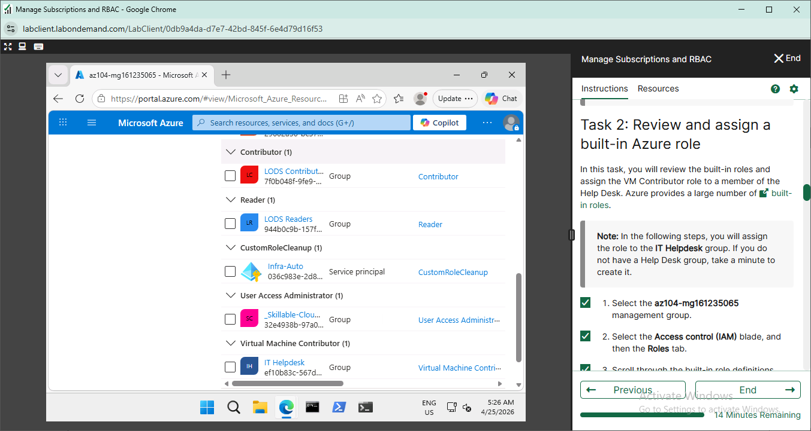
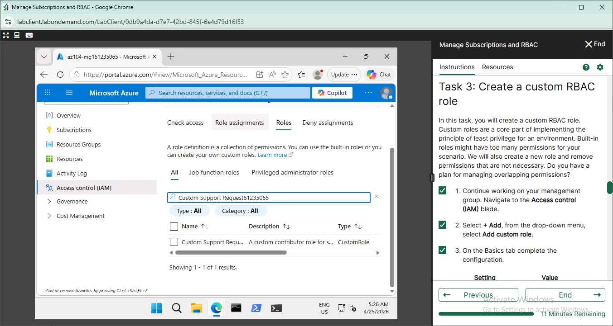

# AZ-104 Lab 02: Manage Subscriptions and RBAC

**Author:** Nenye
**Certification track:** Microsoft Azure Administrator (AZ-104)
**Lab platform:** Microsoft Learn hands-on lab (labondemand)
**Skills demonstrated:** Management groups, Azure RBAC, built-in role assignment, custom role definitions, least privilege

---

## Overview

Role-based access control (RBAC) is how Azure decides who can do what, and where. In this lab I organized access at the management group level, assigned a built-in role to a group, and created a custom role to follow the principle of least privilege.

## Scenario

The organization needs to divide responsibilities across teams while keeping permissions as narrow as possible. The goal was to:

- Group subscriptions under a management group so access can be governed in one place
- Give the help desk team just enough access to manage virtual machines
- Build a custom role for support requests, because built-in roles can carry more permissions than the scenario needs

## Objectives

| # | Task |
|---|------|
| 1 | Implement a management group |
| 2 | Review and assign a built-in Azure role |
| 3 | Create a custom RBAC role |

---

## Task 1: Implement a management group

Management groups sit above subscriptions and let you apply access and policy at scale. Anything assigned to a management group is inherited by every subscription and resource beneath it.

1. In the Azure portal, opened **Management groups**.
2. Created a new management group (`az104-mg161235065` in this lab environment).
3. Confirmed it appeared in the management group hierarchy.

---

## Task 2: Review and assign a built-in Azure role

Azure provides a large catalog of [built-in roles](https://learn.microsoft.com/azure/role-based-access-control/built-in-roles). In this task I reviewed them and assigned the **Virtual Machine Contributor** role to the **IT Helpdesk** group, so help desk staff can manage VMs without getting broader access.

### Steps

1. Selected the `az104-mg161235065` management group.
2. Opened the **Access control (IAM)** blade, then the **Roles** tab.
3. Scrolled through the built-in role definitions to review what each one allows.
4. Created the **IT Helpdesk** group (it did not already exist).
5. Added a role assignment: **Virtual Machine Contributor**, assigned to the **IT Helpdesk** group, at the management group scope.

### Verification

On the **Role assignments** tab, the management group shows **IT Helpdesk** (type: Group) under **Virtual Machine Contributor**, alongside other existing assignments such as Contributor, Reader, and User Access Administrator.

---

## Task 3: Create a custom RBAC role

Custom roles are a core part of implementing least privilege. Built-in roles can include permissions you do not want to grant, so I created a new role based on an existing one and removed the permissions that were not necessary.

### Steps

1. Stayed on the management group and opened **Access control (IAM)**.
2. Selected **+ Add > Add custom role**.
3. On the **Basics** tab, configured the role:
   - **Custom role name:** `Custom Support Request`
   - **Description:** a custom contributor role for support requests
   - **Baseline permissions:** cloned from an existing role (Support Request Contributor)
4. On the **Permissions** tab, excluded the permissions that were not required.
5. On the **Assignable scopes** tab, set the scope to the management group.
6. Reviewed the JSON definition, then selected **Review + create** and **Create**.

> _Fill in the exact permission you excluded and the exact baseline role you cloned, from your own lab steps._

### Verification

Searching the **Roles** tab for the new role returns exactly one result, `Custom Support Request`, with type **CustomRole**, confirming it was created and is available at the management group scope.

---

## Key Takeaways

- **Scope matters.** Assigning a role at the management group level applies it to every subscription and resource underneath, so choose the scope deliberately.
- **Assign roles to groups, not individuals.** Giving the VM Contributor role to the IT Helpdesk group means access follows group membership instead of per-user changes.
- **Least privilege.** Custom roles let me start from a built-in role and remove permissions the scenario does not need.
- **Plan for overlapping permissions.** When a user holds several roles, permissions add up, so overlapping assignments should be reviewed rather than left to accumulate.

## Challenges and Notes

> _Add anything that went wrong or surprised you, such as the Help Desk group not existing, a delay before the role appeared in search, or permission errors._

## Cleanup

> _Note whether you removed the custom role and role assignment afterward, for example with a cleanup step like the `CustomRoleCleanup` assignment visible in the lab._

## References

- [What is Azure RBAC?](https://learn.microsoft.com/azure/role-based-access-control/overview)
- [Azure built-in roles](https://learn.microsoft.com/azure/role-based-access-control/built-in-roles)
- [Azure custom roles](https://learn.microsoft.com/azure/role-based-access-control/custom-roles)
- [What are Azure management groups?](https://learn.microsoft.com/azure/governance/management-groups/overview)

